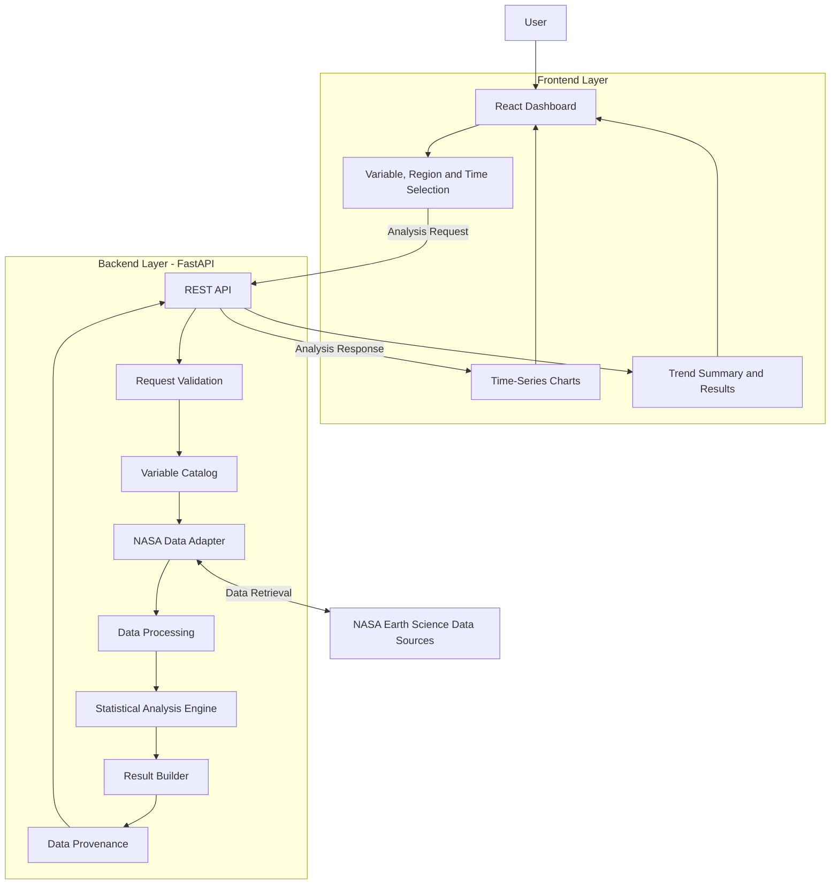
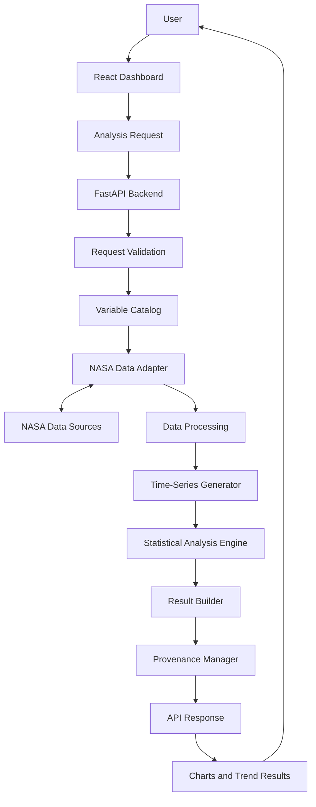

# System Architecture — Earth System Trend Detective

## 1. Introduction

### 1.1 Purpose

This document describes the proposed software architecture of the Earth System Trend Detective platform.

It defines the major system components, their responsibilities, interactions, and the overall data-processing workflow.

The architecture will guide the development and integration of the frontend, backend, NASA data access, and scientific analysis modules.

### 1.2 Architecture Goals

The architecture aims to:

- Provide a modular and maintainable application structure.
- Support integration with verified NASA Earth science data sources.
- Separate data retrieval, processing, statistical analysis, and visualization.
- Ensure scientific transparency and traceability.
- Support future expansion to additional variables, regions, and datasets.

## 2. Proposed Architecture Style

The initial application will follow a **Modular Monolith Architecture**.

The application will be organized into logically separated modules within a single backend application.

### Reasons for This Choice

- Easier development and deployment for a small team.
- Clear separation of responsibilities.
- Simpler integration and testing.
- Ability to extend individual modules without redesigning the entire system.
- Avoidance of unnecessary microservice infrastructure during the initial development phase.

## 3. Technology Direction

The proposed technology stack is:

| Layer | Proposed Technology | Responsibility |
|---|---|---|
| Frontend | React | User interface and dashboard |
| Frontend Language | TypeScript | Type-safe application development |
| Backend | Python | Application logic and data processing |
| Backend Framework | FastAPI | REST API and request handling |
| Data Analysis | Python scientific libraries | Time-series and statistical analysis |
| Visualization | Charting library (to be selected) | Trend charts |
| Version Control | Git and GitHub | Collaboration and source management |

Final technology and library choices may be adjusted during implementation.

## 4. Major System Components

### 4.1 Frontend Layer

Responsible for user interaction and result presentation.

Responsibilities:
- Variable selection
- Geographic region selection
- Time-period selection
- Submission of analysis requests
- Display of time-series charts
- Presentation of trend summaries and statistical results

### 4.2 Backend API Layer

Responsible for receiving and coordinating application requests.

Responsibilities:
- Receive frontend requests
- Validate user inputs
- Coordinate data retrieval and analysis
- Handle application errors
- Return structured responses

### 4.3 Variable Catalog

Maintains information about supported Earth science variables.

Responsibilities:
- Store variable identifiers and names
- Provide descriptions and measurement units
- Identify associated datasets
- Describe temporal and spatial coverage
- Define supported aggregation options

### 4.4 NASA Data Adapter

Responsible for communication with external Earth science data sources.

Responsibilities:
- Retrieve data from configured sources
- Convert source-specific responses into a common internal format
- Handle retrieval errors
- Preserve relevant dataset metadata

The final NASA data source and access method will be selected after dataset evaluation.

### 4.5 Data Processing Module

Responsible for preparing retrieved data for analysis.

Responsibilities:
- Validate observations
- Check missing values
- Handle invalid observations using documented rules
- Verify dates and measurement units
- Generate analysis-ready time-series data

### 4.6 Statistical Analysis Engine

Responsible for identifying and evaluating temporal trends.

Responsibilities:
- Estimate trend direction
- Calculate the rate of change
- Perform an appropriate statistical significance test
- Report relevant statistical evidence and uncertainty

### 4.7 Result and Provenance Module

Responsible for preparing the final analysis output.

Responsibilities:
- Combine analysis results and metadata
- Include dataset and source information
- Include analysis methodology
- Communicate uncertainty and limitations
- Prepare structured responses for the frontend

## 5. Architectural Design Principles

The system will follow these principles:

1. Separation of Concerns: Each component will have a clearly defined responsibility.
2. Modularity: Components should be independently maintainable where possible.
3. Data Transparency: Every scientific result should be linked to its data source.
4. Scientific Integrity: No fabricated observations or unsupported conclusions.
5. Extensibility: Additional datasets and variables should be supported through modular integration.
6. Testability: Processing and analysis components should be independently testable.

## 6. Initial Architecture Status

This architecture is a preliminary design.

The following decisions remain open:

- Final NASA dataset and data access method
- Supported variables and geographic regions
- Spatial and temporal resolution
- Data processing and aggregation rules
- Final statistical methodology
- Deployment infrastructure

These decisions will be updated after data-source evaluation and technical validation.

## 7. High-Level Architecture Diagram




## 8. Component Architecture

### 8.1 Frontend Components

The frontend is responsible for user interaction, analysis configuration, and displaying scientific results.

| Component | Responsibility |
|---|---|
| Dashboard | Main interface and navigation |
| Variable Selector | Allows users to select an Earth science variable |
| Region Selector | Allows users to select a geographic region |
| Time Range Selector | Allows users to specify the analysis period |
| Analysis Controller | Collects user inputs and sends requests to the backend API |
| Time-Series Chart | Visualizes historical data over time |
| Trend Visualization | Displays trend direction, magnitude, and statistical significance |
| Result Panel | Presents analysis summaries and interpretations |
| Provenance Panel | Displays data sources, units, methods, and analysis information |
| Error Display | Shows validation errors and data retrieval failures |


### 8.2 Backend Components

The backend is responsible for processing analysis requests, coordinating data retrieval, executing scientific analysis, and returning structured results.

| Component | Responsibility |
|---|---|
| API Router | Defines REST API endpoints and handles incoming requests |
| Request Validator | Validates variable, region, time range, and other user inputs |
| Variable Catalog | Maintains supported variables, datasets, units, and metadata |
| Analysis Service | Coordinates the complete analysis workflow |
| Data Retrieval Service | Requests data from the appropriate NASA data adapter |
| Data Processing Service | Handles missing values, filtering, aggregation, and preprocessing |
| Statistical Analysis Service | Calculates trend magnitude, direction, and statistical significance |
| Result Builder | Organizes analysis outputs into a structured response |
| Provenance Manager | Records data sources, methods, units, and processing details |
| Error Handler | Handles API, validation, and data retrieval errors |


### 8.3 NASA Data Adapter Components

The NASA Data Adapter layer provides a consistent interface between the backend and external NASA Earth science data sources.

| Component | Responsibility |
|---|---|
| Data Source Registry | Maintains information about supported NASA data products and their access methods |
| Dataset Adapter | Provides a common interface for retrieving data from different NASA datasets |
| MODIS Adapter | Handles data retrieval from supported MODIS products |
| AIRS Adapter | Handles data retrieval from supported AIRS products |
| GPM Adapter | Handles data retrieval from supported GPM products |
| MERRA-2 Adapter | Handles data retrieval from supported MERRA-2 products |
| GLDAS Adapter | Handles data retrieval from supported GLDAS products |
| Metadata Extractor | Extracts dataset metadata, units, timestamps, and spatial information |
| Data Format Handler | Converts retrieved data into a consistent internal format |
| Retrieval Error Handler | Handles unavailable datasets, network failures, and retrieval errors |

**Design Principle:**

All dataset-specific adapters must follow a common interface. This allows the backend to retrieve data without depending on the internal implementation of a particular NASA data source.

Only verified and accessible NASA data products will be enabled in the final implementation.


### 8.4 Statistical Analysis Components

The Statistical Analysis layer processes validated time-series data and identifies long-term trends, their magnitude, and statistical significance.

| Component | Responsibility |
|---|---|
| Time-Series Generator | Organizes processed observations into a chronological time series |
| Temporal Aggregator | Aggregates observations into monthly, seasonal, or annual values |
| Data Quality Checker | Checks missing values, invalid observations, and data consistency |
| Trend Calculator | Calculates the direction and magnitude of a trend |
| Linear Regression Analyzer | Estimates the rate of change using linear regression |
| Mann-Kendall Test | Tests for the presence of a monotonic trend |
| Significance Evaluator | Evaluates statistical significance using appropriate statistical tests |
| Confidence Interval Calculator | Estimates uncertainty around trend statistics |
| Result Interpreter | Converts statistical outputs into understandable scientific summaries |
| Analysis Metadata Recorder | Records the analysis method, parameters, and processing information |

**Scientific Integrity Principles:**

- Missing or invalid observations must be handled using documented rules.
- Statistical methods must be appropriate for the selected dataset and time series.
- Statistical significance must not be confused with practical significance.
- Trend analysis must not be presented as proof of causation.
- Results must include relevant methods, assumptions, and limitations.


## 9. System Data Flow

### 9.1 End-to-End Data Flow

The system follows a structured workflow from user input to scientific result generation.

The main data flow consists of the following stages:

1. User Input: The user selects an Earth science variable, geographic region, and analysis time period.
2. Request Submission: The frontend sends the analysis request to the FastAPI backend.
3. Request Validation: The backend validates the selected variable, region, and time range.
4. Dataset Selection: The Variable Catalog identifies a suitable supported NASA dataset.
5. Data Retrieval: The NASA Data Adapter retrieves the required data from the selected source.
6. Data Processing: Retrieved observations are validated, filtered, and transformed into a consistent time-series format.
7. Statistical Analysis: The Analysis Engine calculates trend magnitude, direction, and statistical significance.
8. Result Generation: The Result Builder prepares the analysis results and supporting metadata.
9. Result Delivery: The backend returns the structured response to the frontend.
10. Visualization: The frontend displays time-series charts, trend summaries, and data provenance.

### 9.2 System Data Flow Diagram



### 9.3 Data Flow Principles

- All analysis requests must pass through backend validation.
- NASA data retrieval must use the appropriate dataset adapter.
- Raw retrieved data must be processed before statistical analysis.
- Statistical results must include relevant metadata and provenance.
- The frontend must display results returned by the backend without inventing scientific values.
- Errors at any stage must produce clear and understandable feedback.

## 10. API Architecture

### 10.1 API Design Overview

The system uses RESTful APIs to enable communication between the React frontend and the FastAPI backend.

The backend exposes structured HTTP endpoints that allow users to retrieve supported variables, inspect available datasets, submit analysis requests, and receive scientific results.

### 10.2 API Endpoints

| Method | Endpoint | Responsibility |
|---|---|---|
| GET | /api/health | Checks backend service availability |
| GET | /api/v1/variables | Returns supported Earth science variables |
| GET | /api/v1/datasets | Returns available verified datasets |
| POST | /api/v1/analysis | Submits a new trend analysis request |
| GET | /api/v1/analysis/{analysis_id} | Retrieves a previously generated analysis result |

### 10.3 Analysis Request Structure

The frontend sends a JSON request to the analysis endpoint.

Example request:

```json
{
  "variable": "temperature",
  "region": {
    "type": "country",
    "name": "Bangladesh"
  },
  "time_range": {
    "start_year": 2000,
    "end_year": 2025
  },
  "temporal_resolution": "monthly"
}
```

### 10.4 Analysis Response Structure

The backend returns a structured JSON response containing the analysis results.

Example response:

```json
{
  "analysis_id": "example-analysis-001",
  "status": "completed",
  "variable": "temperature",
  "region": "Bangladesh",
  "time_range": {
    "start_year": 2000,
    "end_year": 2025
  },
  "trend": {
    "direction": "increasing",
    "magnitude": null,
    "unit": null
  },
  "statistical_significance": {
    "method": "Mann-Kendall",
    "p_value": null,
    "is_significant": null
  },
  "data_source": "Verified NASA dataset",
  "limitations": []
}
```

Note: The response above is a structural example, not an actual scientific result. Numerical values must come from real processed NASA observations.

### 10.5 API Design Principles

- Use standard HTTP methods and meaningful status codes.
- Use JSON for request and response payloads.
- Validate all incoming analysis requests.
- Return clear error messages for invalid or unsuccessful requests.
- Version API endpoints to support future changes.
- Never return fabricated scientific measurements or statistical results.
- Include units, dataset information, and analysis metadata in scientific responses.

## 11. API Error Handling and Response Validation

### 11.1 Error Handling Strategy

The backend must handle errors consistently across all API endpoints. Errors must be reported with meaningful messages without exposing internal system details.

### 11.2 HTTP Status Codes

| Status Code | Meaning | Example |
|---|---|---|
| 200 | OK | Analysis result retrieved successfully |
| 201 | Created | Analysis request successfully created |
| 400 | Bad Request | Invalid request parameters |
| 404 | Not Found | Requested analysis or resource does not exist |
| 422 | Unprocessable Entity | Request validation failed |
| 429 | Too Many Requests | API rate limit exceeded |
| 500 | Internal Server Error | Unexpected backend error |
| 502 | Bad Gateway | External data source returned an invalid response |
| 503 | Service Unavailable | NASA data service or backend dependency is unavailable |
| 504 | Gateway Timeout | External data retrieval timed out |

### 11.3 Standard Error Response Structure

All API errors should follow a consistent JSON structure.

Example:

```json
{
  "status": "error",
  "error": {
    "code": "DATA_SOURCE_UNAVAILABLE",
    "message": "The requested data source is currently unavailable.",
    "details": "Please try again later."
  }
}
```

### 11.4 Input Validation Rules

The backend must validate:

- The requested variable must be supported.
- The selected dataset must be available for the requested variable.
- The geographic region must be valid and supported.
- The start year must be earlier than or equal to the end year.
- The requested time range must be supported by the selected dataset.
- The temporal resolution must be supported.
- Required request fields must not be missing or invalid.

### 11.5 Data Validation Rules

Before statistical analysis, the system must:

- Check whether retrieved data is empty.
- Detect missing and invalid observations.
- Verify timestamps and chronological ordering.
- Check measurement units and metadata.
- Identify insufficient temporal coverage.
- Apply documented missing-data and quality-control rules.

### 11.6 Error Handling Principles

- Errors must be handled at the appropriate system layer.
- External service failures must not crash the entire application.
- Users must receive clear and actionable error messages.
- Internal logs should retain technical details for debugging.
- Invalid or incomplete data must not be presented as valid scientific results.
- The system must distinguish between missing data, retrieval failure, and statistically insignificant trends.
