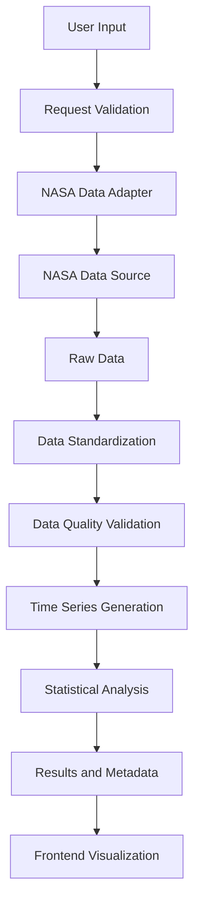

# Data Pipeline Design

## 1. Purpose

This document describes how Earth science data will move through the Earth System Trend Detective system, from data retrieval to final trend analysis.

## 2. Data Pipeline Overview

The system follows these stages:

1. User selects a variable, geographic region and time period.
2. Backend receives and validates the request.
3. NASA Data Adapter retrieves the requested dataset.
4. Raw data is converted into a standardized format.
5. Data processing handles missing values and invalid observations.
6. A time series is generated.
7. Statistical analysis calculates trend results.
8. Results and metadata are returned to the frontend.

## 3. Pipeline Architecture

